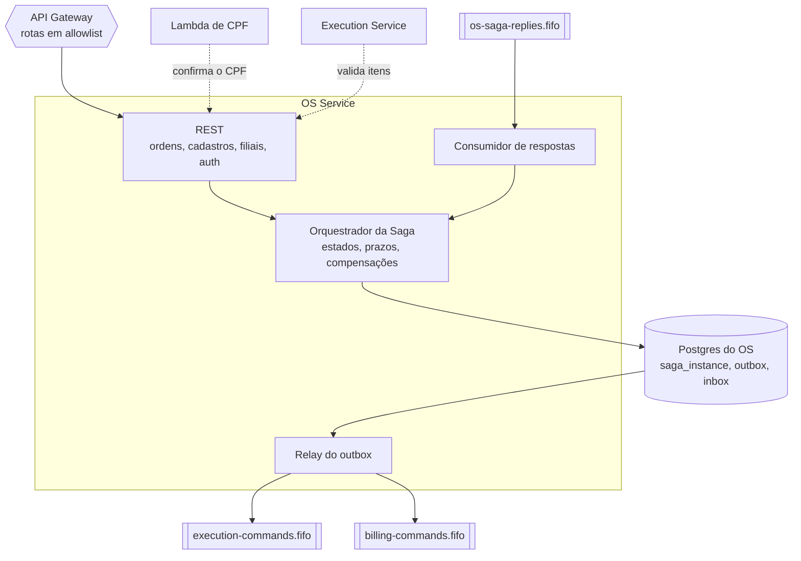
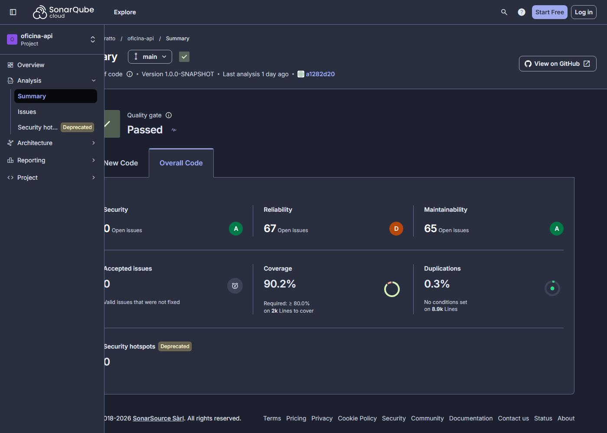

# fiap-fase4-os-service

[](https://sonarcloud.io/summary/overall?id=CleytonOngaratto_fiap-fase4-os-service&branch=main)
[](https://sonarcloud.io/summary/overall?id=CleytonOngaratto_fiap-fase4-os-service&branch=main)

Ordem de Serviço (OS Service) da Fase 4 do Tech Challenge (FIAP SOAT): abertura, status e histórico da OS,
cadastros, filiais e o orquestrador da Saga. Quarkus.

> Evolução de [fiap-fase3-app](https://github.com/CleytonOngaratto/fiap-fase3-app). Arquitetura em
> [`docs/arquitetura/`](docs/arquitetura/README.md), com o [diagrama geral](docs/arquitetura/componentes.md) dos três
> serviços.

## O que este serviço faz

| Responsabilidade | Onde |
|---|---|
| Abrir uma ordem de serviço (cliente, veículo, **relato** e **filial**), consultar status e **histórico** | [`workorder/`](src/main/java/br/com/fiap/postech/carworkshop/workorder) |
| Cadastros e catálogo: clientes, veículos, serviços, peças e estoque | `customer/`, `vehicle/`, `autoservice/`, `inventory/` |
| Filiais onde uma ordem pode ser aberta | [`branch/`](src/main/java/br/com/fiap/postech/carworkshop/branch) |
| Autenticação do atendimento (ADMIN) e o endpoint interno que confirma um CPF para a Lambda de clientes | [`auth/`](src/main/java/br/com/fiap/postech/carworkshop/auth), `customer/adapter/controller` |
| **Orquestrador da Saga**: máquina de estados, prazos, compensações, outbox e inbox | [`saga/`](src/main/java/br/com/fiap/postech/carworkshop/saga) |



As três máquinas de estado envolvidas estão na [máquina de estados](docs/arquitetura/maquina-de-estados.md), e as tabelas, em
[banco-de-dados.md](docs/arquitetura/banco-de-dados.md).

## Saga: estratégia escolhida e por quê

**A Saga é orquestrada, e o orquestrador é código deste serviço.** O estado de cada saga fica na tabela `saga_instance`, no
Postgres do próprio OS. O orquestrador envia **comandos** às filas SQS FIFO dos participantes e reage aos **eventos** que eles
publicam em tópicos SNS FIFO. O que é do próprio OS (precificar, reservar, baixar e devolver peças) acontece na mesma transação
local que avança a saga e grava o próximo comando no outbox.

**O problema.** O processo de uma ordem de serviço atravessa três serviços com bancos próprios e não cabe numa transação: não
existe transação distribuída entre Postgres, DynamoDB, SQS e Mercado Pago, e um *two-phase commit* acoplaria a disponibilidade
de todos. O enunciado pede Saga, com rollback e compensação em qualquer etapa, orquestrada ou coreografada.

**O que decidiu a escolha:**

| Característica do processo | O que ela exige | Como a orquestração atende |
|---|---|---|
| Esperas humanas longas: o cliente aprova em horas, e o mecânico diagnostica quando pode | saber onde cada ordem parou, por muito tempo | o estado persistido em `saga_instance` |
| Pagamento confirmado por webhook do Mercado Pago | reagir a um evento externo no estado certo | o evento chega ao orquestrador, que decide o próximo passo |
| Compensações que dependem do ponto em que a falha ocorreu | saber o que falta desfazer | cada estado da saga tem a sua lista de compensações, e a ordem só fica cancelada quando a última é confirmada |
| Prazos de aprovação e de pagamento | alguém expira e manda compensar | o agendador do orquestrador |
| Fluxo completo em BDD no pull request, sem depender da nuvem | testar o processo inteiro sem a AWS | cenários Cucumber contra o orquestrador real, com os participantes simulados |
| "Em que passo está a OS 42 e o que falta desfazer?" | resposta sem caçar logs em três serviços | uma linha de `saga_instance` |

**Por que não as alternativas:**

- **Coreografia por eventos.** É a mais desacoplada, mas o fluxo ficaria implícito e espalhado em três repositórios: cada serviço
  teria de saber o que desfazer e quando, os prazos não teriam dono natural, "em que passo está" exigiria uma projeção de todos
  os eventos, e o BDD do fluxo completo teria de subir os três serviços.
- **AWS Step Functions.** Foi provada viável no laboratório em 2026-09-29, com sucesso e falha levando à compensação, e
  descartada por escolha. O BDD precisaria de um emulador ou rodaria contra a AWS, fora do pull request; a definição ficaria em
  ASL, fora do código e da cobertura; o orquestrador não pertenceria a nenhum serviço; e uma peça central do domínio ficaria
  presa ao provedor.

**O preço, e como é contido:**

- **Mantemos a máquina de estados.** O pacote `saga` é isolado, com regra própria no ArchUnit, e a matriz de compensação inteira
  é cenário de BDD.
- **O OS vira dependência do processo.** Se ele cair, as sagas param, mas as mensagens esperam nas filas, sem perda. Réplicas,
  HPA, filas de descarte e o alerta de saga parada contêm isso.
- **Não há isolamento entre as etapas.** A reserva de peças funciona como *semantic lock*, a `saga_instance` tem versão
  otimista, a fila é FIFO por ordem de serviço, e existe um passo pivô: depois do reparo concluído, nada mais se desfaz.

**Como é provada.** O job `bdd` roda em todo pull request, como check obrigatório, com 28 cenários contra Postgres e filas FIFO
reais em contêiner e os participantes simulados. As [features](src/test/resources/features/saga) têm 21 cenários e 2 esquemas
com 8 exemplos, e 1 é só do ambiente real. Em 2026-11-05, 14 cenários rodaram contra os três serviços reais no EKS, pelo API
Gateway ([Execução no EKS](docs/arquitetura/matriz-de-compensacao.md#execução-no-eks)).

Detalhes em [ADR-001](docs/arquitetura/adr/ADR-001-saga-orquestrada.md),
[matriz de compensação](docs/arquitetura/matriz-de-compensacao.md) e [sequência da Saga](docs/arquitetura/sequencia.md).

## Tecnologias

| Tecnologia | Versão | Uso |
|---|---|---|
| Java | **17** | linguagem; imagem `eclipse-temurin:17-jre-jammy` |
| Quarkus | **3.26.3** | REST, CDI, configuração e agendamento |
| Hibernate ORM com Panache | 7.1.0 | persistência |
| Flyway | 11.11.2 | migrations |
| PostgreSQL | 16, driver 42.7.7 | banco do serviço; o RDS mediu 16.13 em 2026-10-24 |
| AWS SDK for Java v2 (SQS) | 2.32.4 | filas de comandos e de respostas |
| SmallRye JWT | 4.6.2 | autenticação RS256 |
| SmallRye OpenAPI e Swagger UI | 4.0.12 | especificação da API |
| Micrometer com Prometheus | 1.14.7 | métricas de negócio e de JVM |
| New Relic Java Agent | 9.4.0 | APM, traço distribuído e logs |
| MapStruct · Lombok | 1.5.5.Final · 1.18.30 | mapeamento e redução de código repetitivo |
| JUnit 5 · Mockito · REST Assured | 5.13.4 · 5.18.0 · 5.5.6 | testes de unidade e de API |
| Cucumber (`quarkus-cucumber` 1.3.0) | 7.21.1 | BDD da Saga |
| Testcontainers · Awaitility | 1.21.3 · 4.3.0 | testes com Postgres e filas reais |
| ArchUnit | 1.3.0 | regras de arquitetura |
| JaCoCo | 0.8.12 | cobertura e gate do build |
| SonarCloud (`sonar-maven-plugin`) | 5.8.0.7211 | análise de qualidade no CI |
| Trivy | 0.58.0 | varredura de vulnerabilidades no CI |
| ElasticMQ | 1.7.1 | filas no ambiente local e nos testes |
| Terraform · provider AWS · provider random | 1.15.4 · 6.57.1 · 3.9.0 | infraestrutura do serviço |
| Amazon EKS · kubectl | 1.36 (medido em 2026-10-11) · 1.35.9 | execução e deploy |
| GitHub Actions | — | CI/CD |

## API

A especificação vem do código: o build grava [`docs/api/openapi.yaml`](docs/api/openapi.yaml), e o job `build` falha se o
arquivo versionado divergir do gerado.

| O quê | Onde |
|---|---|
| Swagger UI, com o [ambiente local](#ambiente-local) de pé | `http://localhost:8080/swagger-ui/` |
| OpenAPI em tempo de execução | `http://localhost:8080/carworkshop/v1/q/openapi` |
| Especificação versionada | [`docs/api/openapi.yaml`](docs/api/openapi.yaml) |
| Collection do Postman, com o fluxo completo pelos três serviços | [`docs/api/fluxo-completo.postman_collection.json`](docs/api/fluxo-completo.postman_collection.json) |
| Ambiente de exemplo, com os valores vazios | [`docs/api/gateway.example.postman_environment.json`](docs/api/gateway.example.postman_environment.json) |

O Swagger UI e o `/q/*` não passam pelo API Gateway. O arquivo OpenAPI lista tudo o que a aplicação expõe, inclusive o que o
Gateway não publica: as rotas públicas são as da allowlist, em
[`session/locals.tf`](https://github.com/CleytonOngaratto/fiap-fase4-auth-serverless/blob/main/session/locals.tf), e as demais
estão em [Rotas que não são públicas](#rotas-que-não-são-públicas).

### Como usar a collection

1. Importe a collection e o ambiente e preencha o ambiente: `baseUrl` é o valor de `/fase4/apigw/url`, e `branchId` é uma das
   filiais (`SP-01`, `SP-02` ou `RJ-01`).
2. `adminUsername` e `adminPassword` são os do ADMIN. Depois de um destroy não existe nenhum: o primeiro nasce pelo signup, que
   fica fora do Gateway, com port-forward, como o [`e2e.yml`](.github/workflows/e2e.yml) faz. O signup sem token só vale com a
   tabela de usuários vazia, e depois disso responde 403. Use o mesmo usuário e a mesma senha dos secrets `E2E_ADMIN_USERNAME` e
   `E2E_ADMIN_PASSWORD`, porque o `e2e.yml` trata o 403 como "já existe" e só faz login.
3. Rode pelo Collection Runner ou pelo Newman. As esperas da saga são laços que repetem a requisição e não funcionam no "Send"
   de uma requisição só.
4. A primeira pasta termina imprimindo o link de pagamento. O pagamento é um passo humano: pague no Checkout Pro e só então rode
   a segunda pasta.

```
newman run fluxo-completo.postman_collection.json --folder "1. Até o link de pagamento" -e ambiente.json --export-environment ambiente.json
newman run fluxo-completo.postman_collection.json --folder "2. Depois do pagamento" -e ambiente.json
```

A subpasta "Só OS" roda contra o [ambiente local](#ambiente-local), sem a AWS. O fluxo inteiro só roda na nuvem, porque os três
serviços conversam por SNS e SQS, e o `POST /auth` só existe na Lambda.

## Deploy

Quatro workflows, cada um com um papel:

| Workflow | Gatilho | O que faz |
|---|---|---|
| [`maven-ci.yml`](.github/workflows/maven-ci.yml) | PR e `push` na `main` | build, testes, JaCoCo, análise no SonarCloud (`build` e `SonarCloud Code Analysis` são checks obrigatórios), os cenários da Saga (`bdd`) e Trivy |
| [`e2e.yml`](.github/workflows/e2e.yml) | `workflow_dispatch` | os cenários da Saga contra o EKS, pelo Gateway ([Testes](#testes)) |
| [`terraform.yml`](.github/workflows/terraform.yml) | PR → `fmt-validate` (check obrigatório) + `plan` · `push` na `main` com mudança em `terraform/` → `apply` · `workflow_dispatch` → `plan`/`apply`/`destroy` | a infraestrutura do serviço, em [`terraform/`](terraform/): RDS PostgreSQL, target group `ip` e a regra `/carworkshop/v1/*` no ALB interno da plataforma |
| [`cd.yml`](.github/workflows/cd.yml) | `push` na `main` (fora `*.md`, `docs/` e `terraform/`) e `workflow_dispatch` (com `approval_deadline` e `payment_deadline` opcionais, para os prazos curtos da sessão) | testes → imagem no ECR (tag = SHA do commit) → manifestos no EKS → smoke: alvos `healthy` no target group e, com a borda de pé, `GET /carworkshop/v1/tracking/1` sem token → **401** pelo API Gateway |

**O merge aplica.** Um merge que mude `terraform/` cria ou altera recursos na AWS — só com a sessão do laboratório
ligada e com o teardown na mesma sessão. Num merge com código e `terraform/` os dois workflows rodam juntos: o
`cd.yml` espera o próprio contrato no SSM (até 25 min) e falha dizendo quem publica.

⚠️ **Este serviço depende das filas dos outros.** O `cd.yml` espera as filas de comandos publicadas pelo
`fiap-fase4-execution-service` e pelo `fiap-fase4-billing-service`, porque é para lá que o relay do outbox
envia. Na subida de uma sessão, os dois participantes vão **antes** do OS.

## Mensagens

O orquestrador envia **comandos** para a fila de cada participante e reage aos **eventos** que eles publicam.
Todo comando sai pelo outbox; a fila de destino é resolvida pelo tipo da mensagem.

| Publica | Para onde |
|---|---|
| `StartDiagnosis`, `CancelDiagnosis`, `StartRepair` | `execution-commands.fifo` (fila do Execution) |
| `CreateBudget`, `CancelBudget`, `RequestPayment`, `CancelPayment`, `RefundPayment` | `billing-commands.fifo` (fila do Billing) |

| Consome | Efeito no processo |
|---|---|
| `DiagnosisStarted` | a ordem passa para `UNDER_DIAGNOSIS` |
| `DiagnosisCompleted` | precifica os itens pelo catálogo local e pede o orçamento |
| `BudgetCreated` | a ordem passa para `PENDING_APPROVAL` e abre o prazo de aprovação |
| `BudgetApproved` | **reserva** as peças e pede a cobrança |
| `PaymentRequested` | abre o prazo de pagamento |
| `PaymentConfirmed` | **baixa** as peças reservadas e manda reparar; se a saga já compensou, estorna na hora |
| `RepairStarted`, `RepairCompleted` | acompanha o reparo; concluído é o **pivô**: a ordem vira `COMPLETED` |
| `DiagnosisFailed`, `BudgetCreationFailed`, `BudgetRejected`, `PaymentRequestFailed`, `RepairFailed` | compensa, com o motivo registrado |
| `DiagnosisCanceled`, `BudgetCanceled`, `PaymentCanceled`, `PaymentRefunded` | confirma uma compensação pendente |
| `PaymentAttemptRejected` | informativo: registra a tentativa e segue esperando o prazo |

Todos chegam por `os-saga-replies.fifo`, a fila deste serviço assinada aos tópicos dos participantes.

O envelope e o significado de cada campo estão no
[catálogo de mensagens](docs/arquitetura/catalogo-de-mensagens.md); o porquê da topologia, no
[ADR-006](docs/arquitetura/adr/ADR-006-mensageria.md).

**Nada é publicado fora de transação.** A mensagem é gravada numa tabela de saída (*outbox*) **na mesma
transação** que cria a ordem de serviço — o adaptador exige transação ativa e falha se não houver, em vez de
abrir uma própria e virar escrita dupla. Um *relay* publica as pendentes e marca cada uma como enviada,
reivindicando as linhas com `FOR UPDATE SKIP LOCKED` para que várias réplicas drenem a fila sem publicar a mesma
mensagem duas vezes.

**O consumidor é idempotente duas vezes.** Uma tabela de entrada (*inbox*) registra o identificador da mensagem
**na mesma transação** do efeito: a mesma resposta reentregue não produz efeito nenhum. Além disso, cada
transição do domínio é um não-operação quando o estado já passou dela — resposta fora de ordem não derruba a
ordem de serviço nem vai para a fila de descarte. Resposta para uma ordem inexistente é inconsistência real, e
essa sim fica para o descarte, onde dá para investigar.

**Nenhum comando sem fila bloqueia os outros.** A linha do outbox guarda o destino, e a consulta do relay só
reivindica destinos com fila configurada — sem isso, um comando para um participante ainda não provisionado
ocuparia as vagas do lote e as mensagens atrás dele nunca sairiam.

**O que falha é compensado, não repetido para sempre.** Falta de estoque na reserva é regra de negócio: vira
compensação com motivo `OUT_OF_STOCK`, em vez de reentregar a mensagem até o descarte. Já indisponibilidade de
um participante **não** é resposta de falha: a mensagem espera na fila e a saga retoma de onde parou.

**A ordem só fica cancelada quando a última compensação é confirmada.** Enquanto falta uma, o estado da saga
mostra que ela está compensando e o cliente não vê "cancelado" com dinheiro ainda retido. A ordem das
compensações e o estado final de cada falha estão na
[matriz de compensação](docs/arquitetura/matriz-de-compensacao.md).

## Ambiente local

`docker compose up` sobe o serviço com um **Postgres** e um **ElasticMQ** (API compatível com a de filas da AWS),
com as quatro filas FIFO — comandos, respostas e as duas de descarte — já declaradas em
[`docker/elasticmq/elasticmq.conf`](docker/elasticmq/elasticmq.conf). O contêiner da aplicação roda com o perfil
de produção, então recebe o endereço do emulador, uma credencial fictícia e as URLs das filas por variável de
ambiente. Abrir uma ordem de serviço com tudo de pé é suficiente para ver o outbox sendo drenado para a fila.

Não há emulador de tópicos: a publicação no tópico é verificada por teste de contrato e por um dublê da porta de
saída. Os testes de mensageria sobem os contêineres sozinhos (exigem o Docker em execução).

## Testes

| Comando | O que roda | Onde roda |
|---|---|---|
| `./mvnw clean verify` | Testes unitários e de integração, com o gate de cobertura do JaCoCo | job `build` |
| `./mvnw clean test -Pbdd -Djacoco.skip=true` | Os cenários da Saga, com participantes simulados por fila, contra Postgres e filas FIFO reais em contêiner (exige o Docker) | job `bdd` |
| `mvn clean test -Pe2e -Djacoco.skip=true` | Os mesmos cenários pelo API Gateway, contra o EKS | [`e2e.yml`](.github/workflows/e2e.yml), por `workflow_dispatch` |

Os cenários estão em [`src/test/resources/features/saga/`](src/test/resources/features/saga), um por linha da
[matriz de compensação](docs/arquitetura/matriz-de-compensacao.md). As duas execuções compartilham as features e os
passos; muda só o driver: [`ComponentSagaDriver`](src/test/java/br/com/fiap/postech/carworkshop/bdd/component/ComponentSagaDriver.java)
fala com as filas e o [`EksSagaDriver`](src/test/java/br/com/fiap/postech/carworkshop/bdd/e2e/EksSagaDriver.java), com o Gateway.
Só os cenários com a tag `@e2e` rodam no EKS.

**Rodar no EKS** (cobra enquanto a sessão durar). Rode antes o `cd.yml` por dispatch com `approval_deadline=PT2M` e
`payment_deadline=PT5M`, senão a espera real dos prazos passa do tempo do job, e o pré-voo do `e2e.yml` aborta. O input
`tags` escolhe o que rodar:

| Tags | Cobre |
|---|---|
| `@e2e and not @pagamento and not @infra` | Tudo o que não precisa de ninguém pagando nem derruba pods |
| `@caminho-feliz` e `@F8` | Exigem um pagamento de teste: o link aparece como aviso no log do job |
| `@infra` | F9 e F13: escalam o Execution e o OS para 0 réplicas |

Exige os segredos `E2E_ADMIN_USERNAME` e `E2E_ADMIN_PASSWORD` no repositório. O signup do primeiro ADMIN é idempotente e
passa por `port-forward`, porque essa rota fica fora do Gateway.

### Se o `bdd` travar a `main`

O `bdd` é check obrigatório, e o ruleset não tem `bypass`: um job travado bloqueia **todo** PR deste repositório. Se ele
falhar sem causa no código, rode `gh run rerun --failed <id>` uma vez e investigue. **Quem decide tirar o `bdd` do ruleset é
o dono do repositório**, pela tela do ruleset, que mexe só nesse campo. O check volta assim que o motivo for consertado.

## Evidência de cobertura

| Medida | Valor | Onde se lê |
|---|---|---|
| `coverage` do SonarCloud, o número do badge (soma linhas e condições) | **90,2%** | API do SonarCloud, lida em 2026-11-09 |
| `line_coverage` do SonarCloud | 91,7% | idem |
| `branch_coverage` do SonarCloud | 85,2% | idem |
| Testes | 655, nenhuma falha | `./mvnw clean verify`, em 2026-11-09 |
| JaCoCo `LINE`, o gate do build (mínimo de 80%) | **91,68%** (1830 de 1996 linhas) | idem |

O badge e o gate medem coisas diferentes: o `coverage` do Sonar soma linhas e condições, e o gate do JaCoCo olha só linhas. Por
isso os números não coincidem. Os dois excluem as mesmas classes: as geradas pelo MapStruct, os repositórios e as constantes.



## Contrato no SSM

| Lê | De quem |
|---|---|
| `/fase4/vpc/id`, `/fase4/vpc/private-subnets`, `/fase4/eks/node-sg-id`, `/fase4/alb/listener-arn`, `/fase4/sns/{execution-events,billing-events}/topic-arn` | plataforma ([fiap-fase4-infra-k8s](https://github.com/CleytonOngaratto/fiap-fase4-infra-k8s)), no `terraform/` |
| `/fase4/ecr/os/repo-url`, `/fase4/eks/cluster-name`, `/fase4/alb/sg-id` | plataforma, no `cd.yml` |
| `/fase4/apigw/url` | [fiap-fase4-auth-serverless](https://github.com/CleytonOngaratto/fiap-fase4-auth-serverless), no smoke do `cd.yml` |
| `/fase4/execution/sqs/commands-queue-url` | **[fiap-fase4-execution-service](https://github.com/CleytonOngaratto/fiap-fase4-execution-service)**, no `cd.yml` — fila de comandos do Execution |
| `/fase4/billing/sqs/commands-queue-url` | **[fiap-fase4-billing-service](https://github.com/CleytonOngaratto/fiap-fase4-billing-service)**, no `cd.yml` — fila de comandos do Billing |
| `/fase4/jwt/{private-key,public-key}`, `/fase4/app/secret-key`, `/fase4/newrelic/license-key` | bootstrap manual (sobrevive ao teardown) |

| Publica | Conteúdo |
|---|---|
| `/fase4/os/alb/target-group-arn` | target group que o `TargetGroupBinding` liga aos pods |
| `/fase4/os/rds/{endpoint,port,db-name,username}` | banco do serviço — endpoint só como host |
| `/fase4/os/rds/password` | SecureString; lida só pelo `cd.yml` deste repositório |
| `/fase4/os/sqs/saga-replies-queue-url` | fila de respostas do orquestrador, assinada aos tópicos de eventos dos participantes |
| `/fase4/os/internal/service-token` | SecureString; credencial do endpoint interno, lida por este `cd.yml` e pela Lambda de autenticação ([ADR-007](docs/arquitetura/adr/ADR-007-lambda-sem-banco-do-os.md)) |

## Kubernetes

Tudo no namespace **`os`** ([`k8s/application/`](k8s/application/)): ServiceAccount própria sem token montado,
ConfigMap, Secrets (banco, chave da aplicação e New Relic, par JWT) gerados pelo `cd.yml` a partir do SSM e que só
existem neste namespace, Deployment com HPA, Service `ClusterIP` e o `TargetGroupBinding` que registra os pods no
target group do ALB interno. Nenhum load balancer é criado pelo cluster.

O namespace tem a label `elbv2.k8s.aws/pod-readiness-gate-inject: enabled`: o pod só fica pronto quando o alvo dele
está `healthy` no target group, e o `preStop` segura o encerramento enquanto o ALB drena o alvo — o rollout não
derruba requisição.

A entrada é sempre pelo API Gateway (rotas explícitas por recurso); `/q/*` (health, métricas, OpenAPI) não passa
pelo Gateway e só é usado dentro da VPC.

## Rotas que não são públicas

`GET /carworkshop/v1/internal/customers/{cpf}` confirma, para a Lambda de autenticação, que um CPF pertence a um
cliente — para que ela **não** leia o banco deste serviço. A rota fica fora da allowlist do Gateway **e** exige
uma credencial de serviço na própria aplicação, com comparação em tempo constante; sem o segredo configurado ela
nega todo mundo. Um JWT de ADMIN válido não substitui a credencial. O porquê das duas camadas está no
[ADR-007](docs/arquitetura/adr/ADR-007-lambda-sem-banco-do-os.md).

`POST /carworkshop/v1/auth/signup` cria administradores e **não aceita papéis vindos da requisição**: o papel é
decidido no servidor. Exige um administrador autenticado, com uma exceção de primeiro acesso — enquanto não
existe nenhum usuário, a chamada anônima cria o primeiro, registrando isso no log. O Gateway não publica esta
rota.

`POST /carworkshop/v1/internal/catalog/validate` confirma, para o Execution, que os itens de um diagnóstico existem no
catálogo. Tem a mesma proteção do endpoint de CPF: fora da allowlist e com credencial de serviço.

## Observabilidade

A observabilidade da fase anterior foi reaproveitada (agente Java do New Relic, logs em JSON e métricas Prometheus) e estendida
para seguir uma ordem de serviço pelos três serviços: o `sagaId` liga os logs, e o traço distribuído atravessa a mensageria
([ADR-010](docs/arquitetura/adr/ADR-010-rastreamento-distribuido.md)). O que cada peça faz está em
[componentes.md](docs/arquitetura/componentes.md#observabilidade).

O painel e os alertas são versionados aqui e publicados por script, porque o ambiente é recriado a cada sessão:

| Artefato | Arquivo | Publicado por |
|---|---|---|
| Painel `Car Workshop — Fase 4`: 6 páginas e 29 widgets, com filtro por filial | [`k8s/newrelic/dashboard.json`](k8s/newrelic/dashboard.json) | [`scripts/newrelic-dashboard.ps1`](scripts/newrelic-dashboard.ps1) |
| Política `Car Workshop — Fase 4`: 6 condições | [`k8s/newrelic/alerts.json`](k8s/newrelic/alerts.json) | [`scripts/newrelic-alerts.ps1`](scripts/newrelic-alerts.ps1) |

| Condição | Dispara quando |
|---|---|
| Falha no processamento de OS | resposta 5xx em qualquer um dos 3 serviços |
| Latência alta na API | latência média acima de 2 s por 5 minutos |
| Healthcheck down | nenhum pod de um serviço responde por 5 minutos |
| DLQ com mensagem | uma mensagem parou numa fila de descarte da Saga, e o [runbook](docs/arquitetura/runbook-redrive-dlq.md) diz o que fazer |
| Saga parada além do prazo | aprovação ou pagamento com o prazo vencido há mais de 2 minutos, ou compensação parada há mais de 15 minutos |
| Taxa de falha de pagamento | mais de 2 pagamentos falhando numa janela de 15 minutos |

Os alertas vão para o e-mail do responsável, que vem de um parâmetro do Parameter Store e nunca aparece no repositório. Para
seguir uma ordem inteira nos três serviços: `SELECT * FROM Log WHERE context.sagaId = '<sagaId>'`.

## Decisões

| ADR | Decisão |
|---|---|
| [ADR-001](docs/arquitetura/adr/ADR-001-saga-orquestrada.md) | Saga orquestrada, com o orquestrador em código neste serviço |
| [ADR-002](docs/arquitetura/adr/ADR-002-credencial-dos-pods.md) | Credencial AWS dos pods pela `LabRole` no node group |
| [ADR-003](docs/arquitetura/adr/ADR-003-borda-privada.md) | Borda privada: API Gateway, VPC Link e ALB interno |
| [ADR-004](docs/arquitetura/adr/ADR-004-gateway-persistente.md) | API Gateway persistente, com URL estável entre sessões |
| [ADR-005](docs/arquitetura/adr/ADR-005-divisao-em-servicos.md) | Divisão em três serviços, por responsabilidade de negócio |
| [ADR-006](docs/arquitetura/adr/ADR-006-mensageria.md) | Mensageria: SNS FIFO, SQS FIFO e outbox transacional |
| [ADR-007](docs/arquitetura/adr/ADR-007-lambda-sem-banco-do-os.md) | A Lambda de autenticação não acessa o banco do OS |
| [ADR-008](docs/arquitetura/adr/ADR-008-pagamento-mercado-pago.md) | Pagamento pelo Checkout Pro do Mercado Pago |
| [ADR-009](docs/arquitetura/adr/ADR-009-tabela-unica-do-execution.md) | Tabela única no DynamoDB para o Execution |
| [ADR-010](docs/arquitetura/adr/ADR-010-rastreamento-distribuido.md) | Rastreamento distribuído pela mensageria |
| [ADR-011](docs/arquitetura/adr/ADR-011-bancos-sql-e-nosql.md) | PostgreSQL próprio no OS e no Billing, DynamoDB no Execution |

## Melhorias futuras

O projeto roda no AWS Academy, e parte das escolhas só vale dentro dessas restrições. Cada decisão, com o porquê e o que mudaria
numa conta real, está em [Lab × Produção](docs/arquitetura/lab-vs-producao.md). As principais:

- uma role por serviço (IRSA ou Pod Identity) no lugar da `LabRole` compartilhada, para que o isolamento entre os serviços seja
  garantido por IAM;
- HTTPS de ponta a ponta, WAF e domínio próprio na entrada;
- Multi-AZ, backups e réplicas de leitura nos bancos, e backup contínuo no DynamoDB;
- NAT por AZ, *interface endpoints* e nós em 3 AZs com autoscaler;
- Secrets Manager com rotação e chave KMS própria;
- ambientes separados, sempre ligados, com promoção pelo pipeline;
- teste de carga, que ficou fora do escopo, e a medição da ordem das mensagens no caminho de ida
  ([ADR-006](docs/arquitetura/adr/ADR-006-mensageria.md));
- trocar o runtime `nodejs20.x` da Lambda por um suportado: ele foi descontinuado em 2026-04-30, e a criação de funções com ele
  será bloqueada em 2027-07-29
  ([runtimes do Lambda](https://docs.aws.amazon.com/lambda/latest/dg/lambda-runtimes.html), lido em 2026-11-09).
