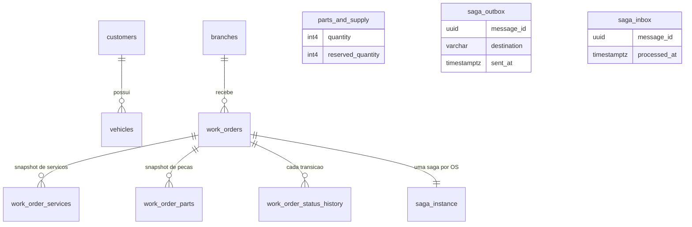

# Banco de dados — Postgres do OS Service

> Escrito no bloco do domínio do OS Service. Os estados que estas tabelas guardam estão na
> [máquina de estados](maquina-de-estados.md); as mensagens que saem e entram, no
> [catálogo de mensagens](catalogo-de-mensagens.md).
> O banco do Billing e a tabela do Execution ganham suas seções nos blocos de cada um.

Cada serviço tem **banco próprio** e ninguém lê o banco do outro: o que atravessa a fronteira é mensagem ou
chamada de API. Este documento descreve o Postgres do OS Service — o único que, nesta fase, guarda **estado de
processo** além de estado de negócio.

## Visão geral



| Tabela | Papel | Migration |
|---|---|---|
| `customers`, `vehicles`, `auto_service`, `parts_and_supply`, `users` | cadastros e catálogo, herdados da fase anterior | V1–V4 |
| `work_orders` | a ordem de serviço: estado visível ao cliente | V1, V4, **V6** |
| `work_order_services`, `work_order_parts` | **snapshot precificado** dos itens do diagnóstico | V1, V4 |
| `branches` | filiais onde uma OS pode ser aberta | **V6** |
| `work_order_status_history` | toda transição de status, com motivo e saga | **V6** |
| `saga_instance` | estado do processo distribuído, uma linha por OS | **V7** |
| `saga_inbox` | mensagens já processadas (idempotência) | **V7** |
| `saga_outbox` | mensagens a publicar, gravadas na transação do estado | V5, **V7** |

## Estado de negócio × estado de processo

`work_orders` responde "o que o cliente vê"; `saga_instance` responde "em que passo o processo está e o que
falta desfazer". São tabelas diferentes de propósito: o status da OS é uma **projeção**, que muda quando a saga
confirma um fato, nunca antes. É por isso que uma OS pode estar `AWAITING_PAYMENT` enquanto a saga já está
`COMPENSATING` — e só vira `CANCELED` quando a última compensação é confirmada.

### `work_orders` — o que a V6 acrescentou

| Coluna | Por quê |
|---|---|
| `branch_id` | filial da abertura; FK para `branches`. Viaja no envelope de toda mensagem e alimenta o filtro por filial nos painéis |
| `customer_document` | **snapshot** do CPF do cliente. É o que permite comparar com o claim `cpf` do token sem consultar o cadastro a cada requisição — e é o mesmo dado que o orçamento leva ao Billing, para ele fazer a mesma checagem |
| `complaint` | o relato do problema, que a abertura passou a receber; segue no `payload` do `StartDiagnosis` |
| `cancel_reason` | motivo do cancelamento, em coluna própria. Leitura única para a consulta do cliente, e fiel ao "toda OS cancelada guarda um motivo" |

⚠️ **`branch_id` e `complaint` são NULL-ável no banco, e obrigatórios na aplicação.** A obrigatoriedade é
validada na abertura, com teste. No banco eles aceitam nulo porque uma OS aberta antes desta fase **não tem**
filial nem relato: preencher com um valor de preenchimento criaria um dado falso, indistinguível do real em
log e em painel. A FK garante a integridade quando o valor existe.

### `work_order_services` e `work_order_parts` — snapshot, não referência

Desde a V4 estas tabelas guardam **descrição e preço copiados** do catálogo, sem FK para ele: o preço de uma OS
é o do momento do diagnóstico, e mudar a tabela de preços não reescreve o passado.

⚠️ **`work_order_parts.quantity` mudou de significado nesta fase.** Era a *quantidade em estoque da peça* no
momento da abertura (cópia sem utilidade); agora é a **quantidade pedida pelo diagnóstico**, que é o que a
reserva, a baixa e o total do orçamento usam.

A chave primária é composta — `(work_order_id, auto_service_id)` e `(work_order_id, parts_and_supply_id)` —,
então um diagnóstico que repita o mesmo item do catálogo é **somado numa linha** antes da gravação; inserir
duas vezes violaria a chave e mandaria a resposta do participante para a DLQ.

### `work_order_status_history` — a consulta de histórico

Uma linha por transição, com `status`, instante, `reason`, `saga_id` e `branch_id`. É o que atende "consulta de
status e histórico" e fecha a lacuna da fase anterior, que só tinha data de criação e data de fim.

O `branch_id` é **denormalizado de propósito**: a filial da OS é imutável, e tê-la na linha evita o join nas
consultas e nos painéis por filial. O `saga_id` liga a transição ao processo que a causou — é o que permite
olhar uma OS e saber qual saga a moveu.

## Os três mecanismos que sustentam a saga

### `saga_outbox` — "commit e publicar" num só ato

Nunca se grava o estado e depois se publica a mensagem: um crash no meio perderia o evento ou publicaria um
evento fantasma. A linha do outbox é gravada **na mesma transação** do estado, e um *relay* publica depois.

| Coluna | Papel |
|---|---|
| `message_id` (PK) | chave de idempotência e `MessageDeduplicationId` da fila FIFO |
| `destination` | para qual participante o comando vai (`EXECUTION`, `BILLING`) |
| `sent_at` | nulo = pendente. O relay reivindica os pendentes com `FOR UPDATE SKIP LOCKED`, para várias réplicas drenarem sem publicar duas vezes |
| `branch_id`, `correlation_id`, `causation_id` | campos do envelope que precisam sobreviver ao salto pela tabela |

A coluna `destination` existe por um motivo de desenho, não de informação: a consulta do relay filtra pelos
destinos **que têm fila configurada**. Sem esse filtro, um comando sem destino configurado ocuparia as vagas do
`LIMIT` e as mensagens atrás dele **nunca sairiam** — o bloqueio de cabeça de fila clássico. O índice parcial
`(destination, occurred_at) WHERE sent_at IS NULL` serve exatamente essa consulta.

⚠️ `destination` tem `DEFAULT 'EXECUTION'` **por causa do rollout**: num redeploy, o pod novo aplica a migration
enquanto os antigos ainda inserem no outbox sem a coluna; sem o default, o `INSERT` deles falharia e a abertura
de OS devolveria 500 durante a troca.

### `saga_inbox` — a mesma mensagem duas vezes não faz duas vezes

O SQS entrega **ao menos uma vez**. A linha da inbox (`message_id` como PK) é gravada na mesma transação do
efeito: se a mensagem voltar, a inserção não acontece e o efeito não se repete. Antes desta fase a idempotência
era só por checagem de estado — o que cobria "a OS já avançou", mas não "esta mensagem já foi processada".

### `saga_instance` — o estado do processo

Uma linha por OS (`work_order_id` com chave única), com o estado da máquina, os identificadores que os
participantes devolveram (`budget_id`, `payment_id`), o prazo em curso e as compensações que faltam.

| Coluna | Papel |
|---|---|
| `state` | o passo atual, entre os 11 estados da máquina |
| `pending_compensations` | as compensações já despachadas que ainda aguardam confirmação. Enquanto não esvazia, a saga fica `COMPENSATING` e a OS **não** vira `CANCELED` |
| `deadline_at` | prazo de aprovação ou de pagamento. O *scheduler* reivindica os vencidos com `FOR UPDATE SKIP LOCKED`, para duas réplicas não compensarem a mesma saga |
| `version` | controle otimista: o *scheduler* de prazos e o consumidor de respostas podem tocar a mesma saga ao mesmo tempo, e só um vence; o outro relê e decide de novo |

## Estoque: reservar antes de cobrar

`parts_and_supply` ganhou `reserved_quantity`, e **disponível = `quantity` − `reserved_quantity`**. O ciclo:

```
aprovação do orçamento  → reserve            (reserved += n, quantity intacto)
pagamento confirmado    → confirmReservation (quantity -= n, reserved -= n)
prazo vencido / falha   → releaseReservation (reserved -= n, quantity intacto)
falha no reparo         → restore            (quantity += n, depois da baixa)
```

É o *semantic lock*: a peça fica indisponível para outra OS **sem** sair do estoque, porque o pagamento ainda
pode não vir. Duas consequências que viraram regra no código:

1. **A reserva valida todas as peças antes de mexer em qualquer uma.** Falta de estoque é regra de negócio e
   vira compensação (`OUT_OF_STOCK`), não reentrega da mensagem até a DLQ — e, sem a validação prévia, a
   exceção deixaria parte das reservas aplicadas na mesma transação.
2. **A baixa manual do atendimento respeita a reserva.** O endpoint de consumo e o de atualização de estoque
   validam contra o **disponível**, não contra o total: sem isso, um ajuste do atendimento comeria unidades
   reservadas para uma OS em andamento e deixaria o disponível negativo.

## Convenções

- **Migrations versionadas pelo Flyway**, aplicadas no start da aplicação. Coluna obrigatória em tabela com
  dados segue o padrão da V4: cria nula → preenche a partir da fonte verdadeira → só então restringe. Onde não
  existe fonte verdadeira, a coluna continua nula no banco e obrigatória na aplicação.
- **Nada de `DELETE` em ordem de serviço:** a exclusão é lógica (`deleted`), e só depois do serviço terminado.
- **Nenhum segredo e nenhum identificador de conta neste documento.** Senha do banco e credenciais vivem no
  Parameter Store; o endpoint muda a cada sessão do laboratório.

## Evidências

| Data | Evidência |
|---|---|
| 2026-10-22 | `./mvnw clean verify` com 562 testes verdes, cobertura de linha 89,2%; a V5.0.0 aplicada pelo Flyway em Postgres real no teste de mensageria (Testcontainers) |
| 2026-10-22 | Reserva, baixa, liberação e devolução provadas em teste puro, incluindo a recusa quando o pedido passa do disponível e a recusa da baixa manual sobre unidade reservada |
