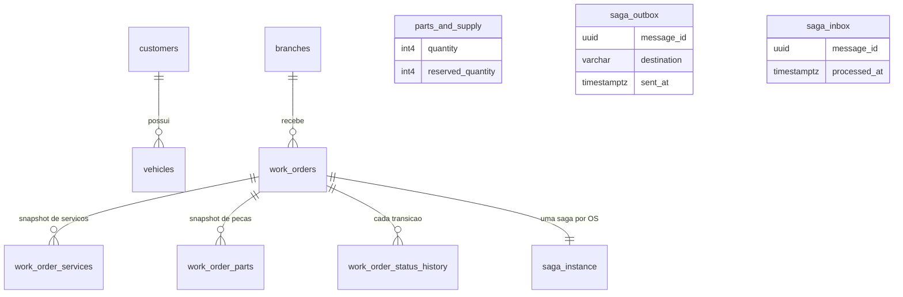
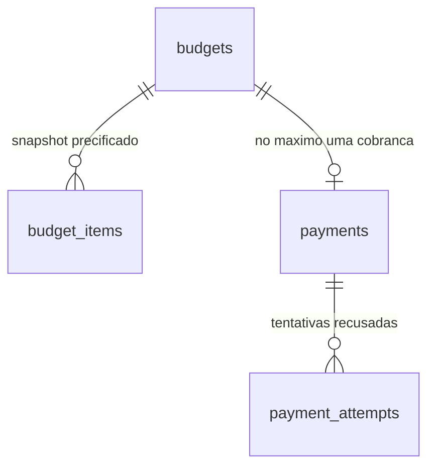

# Banco de dados — os dois Postgres e o DynamoDB

> Escrito no bloco do domínio do OS Service; a seção do Billing entrou no bloco dele. Os estados que
> estas tabelas guardam estão na
> [máquina de estados](maquina-de-estados.md); as mensagens que saem e entram, no
> [catálogo de mensagens](catalogo-de-mensagens.md).
> A tabela do Execution ganha sua seção no bloco dele.

Cada serviço tem **banco próprio** e ninguém lê o banco do outro: o que atravessa a fronteira é mensagem ou
chamada de API. Este documento descreve os dois bancos relacionais da fase, o do OS Service e o do Billing
Service: os dois guardam **estado de processo** além de estado de negócio, porque os dois participam da saga.

## Visão geral



| Tabela | Papel | Migration |
|---|---|---|
| `customers`, `vehicles`, `auto_service`, `parts_and_supply`, `users` | cadastros e catálogo, herdados da fase anterior | V1–V4 |
| `work_orders` | a ordem de serviço: estado visível ao cliente | V1, V4, **V6** |
| `work_order_services`, `work_order_parts` | **snapshot precificado** dos itens do diagnóstico | V1, V4 |
| `branches` | filiais onde uma OS pode ser aberta | **V6** |
| `work_order_status_history` | toda transição de status, com motivo e saga | **V6** |
| `saga_instance` | estado do processo distribuído, uma linha por OS | **V7** |
| `saga_inbox` | mensagens já processadas (idempotência) | **V7** |
| `saga_outbox` | mensagens a publicar, gravadas na transação do estado | V5, **V7** |

## Estado de negócio × estado de processo

`work_orders` responde "o que o cliente vê"; `saga_instance` responde "em que passo o processo está e o que
falta desfazer". São tabelas diferentes de propósito: o status da OS é uma **projeção**, que muda quando a saga
confirma um fato, nunca antes. É por isso que uma OS pode estar `AWAITING_PAYMENT` enquanto a saga já está
`COMPENSATING` — e só vira `CANCELED` quando a última compensação é confirmada.

### `work_orders` — o que a V6 acrescentou

| Coluna | Por quê |
|---|---|
| `branch_id` | filial da abertura; FK para `branches`. Viaja no envelope de toda mensagem e alimenta o filtro por filial nos painéis |
| `customer_document` | **snapshot** do CPF do cliente. É o que permite comparar com o claim `cpf` do token sem consultar o cadastro a cada requisição — e é o mesmo dado que o orçamento leva ao Billing, para ele fazer a mesma checagem |
| `complaint` | o relato do problema, que a abertura passou a receber; segue no `payload` do `StartDiagnosis` |
| `cancel_reason` | motivo do cancelamento, em coluna própria. Leitura única para a consulta do cliente, e fiel ao "toda OS cancelada guarda um motivo" |

⚠️ **`branch_id` e `complaint` são NULL-ável no banco, e obrigatórios na aplicação.** A obrigatoriedade é
validada na abertura, com teste. No banco eles aceitam nulo porque uma OS aberta antes desta fase **não tem**
filial nem relato: preencher com um valor de preenchimento criaria um dado falso, indistinguível do real em
log e em painel. A FK garante a integridade quando o valor existe.

### `work_order_services` e `work_order_parts` — snapshot, não referência

Desde a V4 estas tabelas guardam **descrição e preço copiados** do catálogo, sem FK para ele: o preço de uma OS
é o do momento do diagnóstico, e mudar a tabela de preços não reescreve o passado.

⚠️ **`work_order_parts.quantity` mudou de significado nesta fase.** Era a *quantidade em estoque da peça* no
momento da abertura (cópia sem utilidade); agora é a **quantidade pedida pelo diagnóstico**, que é o que a
reserva, a baixa e o total do orçamento usam.

A chave primária é composta — `(work_order_id, auto_service_id)` e `(work_order_id, parts_and_supply_id)` —,
então um diagnóstico que repita o mesmo item do catálogo é **somado numa linha** antes da gravação; inserir
duas vezes violaria a chave e mandaria a resposta do participante para a DLQ.

### `work_order_status_history` — a consulta de histórico

Uma linha por transição, com `status`, instante, `reason`, `saga_id` e `branch_id`. É o que atende "consulta de
status e histórico" e fecha a lacuna da fase anterior, que só tinha data de criação e data de fim.

O `branch_id` é **denormalizado de propósito**: a filial da OS é imutável, e tê-la na linha evita o join nas
consultas e nos painéis por filial. O `saga_id` liga a transição ao processo que a causou — é o que permite
olhar uma OS e saber qual saga a moveu.

## Os três mecanismos que sustentam a saga

### `saga_outbox` — "commit e publicar" num só ato

Nunca se grava o estado e depois se publica a mensagem: um crash no meio perderia o evento ou publicaria um
evento fantasma. A linha do outbox é gravada **na mesma transação** do estado, e um *relay* publica depois.

| Coluna | Papel |
|---|---|
| `message_id` (PK) | chave de idempotência e `MessageDeduplicationId` da fila FIFO |
| `destination` | para qual participante o comando vai (`EXECUTION`, `BILLING`) |
| `sent_at` | nulo = pendente. O relay reivindica os pendentes com `FOR UPDATE SKIP LOCKED`, para várias réplicas drenarem sem publicar duas vezes |
| `branch_id`, `correlation_id`, `causation_id` | campos do envelope que precisam sobreviver ao salto pela tabela |

A coluna `destination` existe por um motivo de desenho, não de informação: a consulta do relay filtra pelos
destinos **que têm fila configurada**. Sem esse filtro, um comando sem destino configurado ocuparia as vagas do
`LIMIT` e as mensagens atrás dele **nunca sairiam** — o bloqueio de cabeça de fila clássico. O índice parcial
`(destination, occurred_at) WHERE sent_at IS NULL` serve exatamente essa consulta.

⚠️ `destination` tem `DEFAULT 'EXECUTION'` **por causa do rollout**: num redeploy, o pod novo aplica a migration
enquanto os antigos ainda inserem no outbox sem a coluna; sem o default, o `INSERT` deles falharia e a abertura
de OS devolveria 500 durante a troca.

### `saga_inbox` — a mesma mensagem duas vezes não faz duas vezes

O SQS entrega **ao menos uma vez**. A linha da inbox (`message_id` como PK) é gravada na mesma transação do
efeito: se a mensagem voltar, a inserção não acontece e o efeito não se repete. Antes desta fase a idempotência
era só por checagem de estado — o que cobria "a OS já avançou", mas não "esta mensagem já foi processada".

### `saga_instance` — o estado do processo

Uma linha por OS (`work_order_id` com chave única), com o estado da máquina, os identificadores que os
participantes devolveram (`budget_id`, `payment_id`), o prazo em curso e as compensações que faltam.

| Coluna | Papel |
|---|---|
| `state` | o passo atual, entre os 11 estados da máquina |
| `pending_compensations` | as compensações já despachadas que ainda aguardam confirmação. Enquanto não esvazia, a saga fica `COMPENSATING` e a OS **não** vira `CANCELED` |
| `deadline_at` | prazo de aprovação ou de pagamento. O *scheduler* reivindica os vencidos com `FOR UPDATE SKIP LOCKED`, para duas réplicas não compensarem a mesma saga |
| `version` | controle otimista: o *scheduler* de prazos e o consumidor de respostas podem tocar a mesma saga ao mesmo tempo, e só um vence; o outro relê e decide de novo |

## Estoque: reservar antes de cobrar

`parts_and_supply` ganhou `reserved_quantity`, e **disponível = `quantity` − `reserved_quantity`**. O ciclo:

```
aprovação do orçamento  → reserve            (reserved += n, quantity intacto)
pagamento confirmado    → confirmReservation (quantity -= n, reserved -= n)
prazo vencido / falha   → releaseReservation (reserved -= n, quantity intacto)
falha no reparo         → restore            (quantity += n, depois da baixa)
```

É o *semantic lock*: a peça fica indisponível para outra OS **sem** sair do estoque, porque o pagamento ainda
pode não vir. Duas consequências que viraram regra no código:

1. **A reserva valida todas as peças antes de mexer em qualquer uma.** Falta de estoque é regra de negócio e
   vira compensação (`OUT_OF_STOCK`), não reentrega da mensagem até a DLQ — e, sem a validação prévia, a
   exceção deixaria parte das reservas aplicadas na mesma transação.
2. **A baixa manual do atendimento respeita a reserva.** O endpoint de consumo e o de atualização de estoque
   validam contra o **disponível**, não contra o total: sem isso, um ajuste do atendimento comeria unidades
   reservadas para uma OS em andamento e deixaria o disponível negativo.

## Postgres do Billing Service

Instância própria, banco próprio: o Billing não lê nem escreve no banco do OS, e vice-versa. Guarda o
orçamento, a cobrança e — como o OS — o **estado de processo** da sua parte da saga, nas mesmas duas tabelas
de mensageria.



Além dessas quatro, `saga_inbox` e `saga_outbox`, idênticas em papel às do OS.

### `budgets` — um orçamento por ordem de serviço

`id` é **UUID gerado na aplicação** — ele vai no `external_reference` da cobrança e volta na notificação do
provedor, então precisa existir antes de qualquer `INSERT` e não pode ser adivinhável por quem recebe o link.
`work_order_id` é **UNIQUE**, e é essa constraint que torna `CreateBudget` idempotente pela chave de negócio:
a reentrega do comando devolve o mesmo orçamento e a mesma resposta, em vez de criar um segundo.

O `approval_deadline` chega no comando e é **verificado na aprovação**: orçamento aprovado depois do prazo
responde **409**. Sem isso, um orçamento que ficou órfão — porque a ordem foi cancelada antes de a saga
registrar o passo de cancelá-lo — continuaria aprovável para sempre, e nasceria uma cobrança para uma ordem
que já não existe.

### `budget_items` — chave composta, não sequencial

PK composta por `budget_id` + `type` + `catalog_id`. O motivo é o mesmo do snapshot do OS: o item repetido no
mesmo orçamento é erro de origem, e com chave sequencial ele entraria duas vezes em silêncio. Com a chave
composta, o segundo `INSERT` falha — e falha **antes** de a mensagem ser confirmada.

Os preços ficam **congelados** aqui: `unit_price` é o preço no momento do diagnóstico, não uma referência ao
catálogo. Reajuste de tabela não muda orçamento já emitido.

### `payments` — uma cobrança por orçamento, com a chave do estorno

`budget_id` é **UNIQUE**: um orçamento tem no máximo uma cobrança, e `RequestPayment` reentregue reaproveita
a que existe em vez de criar a segunda.

`refund_idempotency_key` é **NOT NULL** e nasce junto com a cobrança, muito antes de existir qualquer estorno.
É ela que vai no header `X-Idempotency-Key` em **toda** tentativa de estorno — a do retry e a do estorno
automático do pagamento tardio. Gerá-la na hora do estorno faria cada retentativa pedir um estorno novo.

`cancel_reason` distingue os dois caminhos que levam ao mesmo estado final: `REJECTED_BY_CUSTOMER` e
`PAID_AFTER_CANCELLATION`. Sem a coluna, um pagamento `REFUNDED` não diria se foi compensação pedida pelo
orquestrador ou dinheiro devolvido por iniciativa do próprio serviço.

### `payment_attempts` — tentativa recusada é linha, não mudança de estado

Cartão recusado não muda o estado da cobrança: ela continua `PENDING` e o cliente pode tentar de novo até o
prazo. Cada recusa vira uma linha, e o evento que sai é informativo.

Três detalhes aqui foram escolhidos contra bugs silenciosos:

1. **PK própria (`id bigserial`).** A tabela é um log; sem chave primária a entidade não existe para o
   mapeamento objeto-relacional.
2. **`UNIQUE (payment_id, mp_payment_id, status_detail)`.** O provedor reentrega notificação; sem a
   constraint, a mesma recusa viraria duas linhas e dois eventos.
3. **`status_detail` é NOT NULL**, com um valor de preenchimento posto pela aplicação quando o provedor não
   manda nenhum. No PostgreSQL, **NULL é distinto de NULL numa constraint `UNIQUE`** — duas notificações sem
   detalhe entrariam as duas — e a consulta `status_detail = ?` com NULL **nunca** é verdadeira, então a
   verificação prévia também falharia. A deduplicação furaria nos dois caminhos ao mesmo tempo, em silêncio.

A deduplicação em si **não** depende de a constraint estourar: o caminho normal é consultar e então inserir,
devolvendo um booleano. No PostgreSQL um `INSERT` que viola constraint **aborta a transação inteira**, e dali
não há como seguir nem responder ao orquestrador — a constraint é rede de segurança para concorrência, não o
mecanismo.

### `saga_inbox` e `saga_outbox` — os mesmos dois mecanismos

Idênticas às do OS em papel e em formato: a inbox grava o `messageId` **na mesma transação** do efeito, e a
outbox torna "gravar o estado e publicar o evento" um ato só. O relay drena com `FOR UPDATE SKIP LOCKED`, e o
índice parcial `WHERE sent_at IS NULL` mantém a varredura proporcional ao que falta enviar, não ao histórico.

Esse índice parcial é também o motivo de as migrations do Billing **não** rodarem no banco em memória dos
testes: o H2 não o suporta. O esquema dos testes vem do mapeamento objeto-relacional, e as migrations são
exercidas contra um **PostgreSQL de verdade** em container — que é onde as constraints acima são provadas, uma
a uma.

## Convenções

- **Migrations versionadas pelo Flyway**, aplicadas no start da aplicação. Coluna obrigatória em tabela com
  dados segue o padrão da V4: cria nula → preenche a partir da fonte verdadeira → só então restringe. Onde não
  existe fonte verdadeira, a coluna continua nula no banco e obrigatória na aplicação.
- **Nada de `DELETE` em ordem de serviço:** a exclusão é lógica (`deleted`), e só depois do serviço terminado.
- **Nenhum segredo e nenhum identificador de conta neste documento.** Senha do banco e credenciais vivem no
  Parameter Store; o endpoint muda a cada sessão do laboratório.

## DynamoDB do Execution Service — uma tabela só

O terceiro banco não é SQL, e a razão está na [ADR-009](adr/ADR-009-tabela-unica-do-execution.md): o acesso é
sempre **por ordem de serviço** ou **por filial e status**, nunca por junção. Uma tabela guarda quatro tipos de
item, distinguidos pela chave de ordenação:

| `pk` | `sk` | O que é | Índice que o alcança |
|---|---|---|---|
| `WO#<id>` | `STATE` | o item de execução: status, filial, `sagaId`, placa, relato, mecânico, descrição do diagnóstico, itens, versão | `gsi-branch-status` |
| `WO#<id>` | `STEP#<instante>#<ação>` | histórico de etapas, só acréscimo | — (lido pela partição da OS) |
| `WO#<id>` | `INBOX#<messageId>` | marca de comando processado, com TTL | — |
| `WO#<id>` | `OUTBOX#<messageId>` | evento a publicar; `sentAt` ausente = pendente | `gsi-outbox-pending` |

**Por que tudo na mesma partição da OS:** é o que permite gravar estado, histórico, inbox e outbox num único
`TransactWriteItems`. Ou os quatro entram, ou nenhum entra — o mesmo "commit e publicar num só ato" que o
`saga_outbox` dá no Postgres, sem transação distribuída.

**`gsi-branch-status`** — chave de partição `<branchId>#<status>`, ordenação `enqueuedAt`. É a fila do mecânico:
"as ordens da filial SP-01 esperando diagnóstico, a mais antiga primeiro" é uma única consulta, sem filtro e sem
varredura. Só o item `STATE` carrega essas chaves (índice esparso), então histórico, inbox e outbox não entram
nele. ⚠️ Ao chegar a um estado terminal o item **reescreve** a chave com o status novo em vez de removê-la: sai
da fila porque mudou de partição, e continua consultável por `CANCELED` ou `REPAIR_DONE`.

**`gsi-outbox-pending`** — partição constante `PENDING`, ordenação `occurredAt`. Existe porque o relay precisa
achar pendências **de todas as ordens**, e sem índice isso seria uma varredura da tabela. Ao marcar `sentAt`, o
relay **remove** as duas chaves e o item sai do índice. Partição única é adequada ao volume do projeto e está
registrada em "Lab × Produção": numa conta real a chave seria fragmentada (`OUTBOX#<shard>`) para não
concentrar escrita numa partição.

**Concorrência sem `SELECT ... FOR UPDATE`.** Cada transição condiciona a escrita ao **status e à versão** que a
leitura devolveu (leitura forte, `ConsistentRead`), e a versão sobe a cada gravação. Quem perde a corrida não
sobrescreve: recebe a transação cancelada e responde 409 (pedido humano) ou segue sem alterar (comando da
saga). A inbox usa `attribute_not_exists` na própria chave, e é por isso que a reentrega do mesmo `messageId`
não gera segundo efeito **nem segunda resposta**.

**O que o DynamoDB não dá, e como se resolve.** Não há `SKIP LOCKED`: com duas réplicas, as duas leem o mesmo
lote de pendências. Quem perde a condição `attribute_not_exists(sentAt)` não remarca, mas a mensagem pode sair
duas vezes. A garantia durável contra isso **não** é a janela de deduplicação do SNS (5 minutos, insuficiente se
o item ficar pendente mais que isso): é a `saga_inbox` do OS Service, que deduplica por `messageId` — e é por
isso que o `messageId` do evento de resposta é **derivado do comando**, não aleatório.

## Evidências

| Data | Evidência |
|---|---|
| 2026-10-22 | `./mvnw clean verify` com 562 testes verdes, cobertura de linha 89,2%; a V5.0.0 aplicada pelo Flyway em Postgres real no teste de mensageria (Testcontainers) |
| 2026-10-22 | Reserva, baixa, liberação e devolução provadas em teste puro, incluindo a recusa quando o pedido passa do disponível e a recusa da baixa manual sobre unidade reservada |
| 2026-10-25 | Billing: `./mvnw clean verify` com 165 testes verdes e cobertura de linha 97,8%; V1.0.0 e V2.0.0 aplicadas pelo Flyway em PostgreSQL 16 real (Testcontainers), com o índice parcial `WHERE sent_at IS NULL` conferido em `pg_indexes` |
| 2026-10-25 | Billing: o banco real **recusa** o segundo orçamento com o mesmo `work_order_id` e a segunda notificação com a mesma tripla `(payment_id, mp_payment_id, status_detail)` |
| 2026-10-30 | Execution: `./mvnw clean verify` com 137 testes verdes e cobertura de linha 99,2%; *round-trip* do item `STATE` tocando os 14 campos, e a tabela criada pelo teste de integração com as mesmas chaves e índices do `terraform/dynamodb.tf` |
