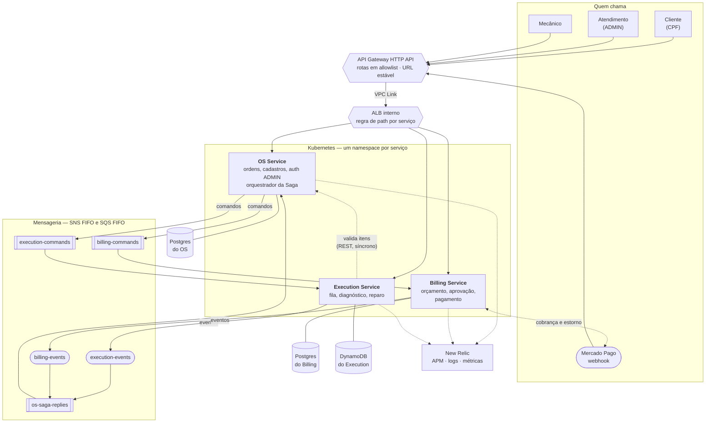

# Componentes — visão geral da Fase 4

> Escrito em 2026-10-18, no bloco do esqueleto andante. Os estados que estes componentes movem estão na
> [máquina de estados](maquina-de-estados.md); as mensagens que trafegam entre eles, no
> [catálogo de mensagens](catalogo-de-mensagens.md).

Três microsserviços independentes, cada um com repositório, infraestrutura e banco próprios. Nenhum deles lê o
banco de outro: o que atravessa a fronteira é **mensagem** ou **chamada de API**.

## Diagrama

## Quem é dono de quê

| Componente | Dono | Guarda | Fala com os outros por |
|---|---|---|---|
| **OS Service** | ordem de serviço, clientes, veículos, catálogo de serviços e peças, estoque, autenticação do ADMIN, **estado da Saga** | Postgres próprio | comandos no outbox; consome as respostas dos participantes |
| **Billing Service** | orçamento, aprovação do cliente, cobrança e estorno | Postgres próprio | consome comandos; publica eventos; chama o Mercado Pago |
| **Execution Service** | fila de execução por filial, diagnóstico e reparo | DynamoDB | consome comandos; publica eventos; consulta o catálogo do OS por REST |
| **Borda** | API Gateway, VPC Link, rotas | — | integra com o ALB interno; nenhum balanceador público |
| **Plataforma** | VPC, cluster, registries, ALB interno, **tópicos SNS** | — | publica o contrato no Parameter Store |

Os tópicos ficam na plataforma porque são o **contrato público de eventos**; cada fila fica no repositório de
quem a consome. O contrato entre repositórios é o Parameter Store sob `/fase4/`: cada um publica o que cria e
lê o que precisa, sem nenhum identificador fixo no código.

## Por que cada travessia de fronteira é assim

| Travessia | Forma | Por quê |
|---|---|---|
| Orquestrador → participante | **comando** numa fila ponto a ponto | o orquestrador fala com **um** destinatário, e a fila segura o participante fora do ar |
| Participante → orquestrador | **evento** num tópico, entregue na fila de respostas | o fato é público; quem tiver interesse assina, sem o participante conhecer o consumidor |
| Execution → catálogo do OS | **REST síncrono** | é feedback a um humano: item inválido tem de voltar na hora ao mecânico |
| Billing → Mercado Pago | REST síncrono, com confirmação por consulta | o webhook só avisa; o status verdadeiro vem da consulta ao pagamento |
| Pessoas → serviços | HTTPS pelo Gateway, com JWT | única porta de entrada; as rotas são uma allowlist explícita |

## Observabilidade

Uma entidade de APM **por serviço**, com o agente embutido na imagem. Os logs saem em JSON com
`correlationId` e `sagaId` como campos, o que permite seguir **a mesma ordem de serviço nos três serviços** com
uma consulta só. As métricas de negócio da fase anterior continuam, agora com a filial como dimensão.

## O que ainda não existe

Este diagrama é o alvo da fase. No bloco do esqueleto andante existem, de ponta a ponta, apenas o caminho
`StartDiagnosis` → `DiagnosisStarted`: a fila de comandos do Execution, a fila de respostas do OS e o outbox do
OS. O banco do Billing, a tabela do Execution, a fila de comandos do Billing e a integração com o Mercado Pago
entram nos blocos de domínio de cada serviço.
