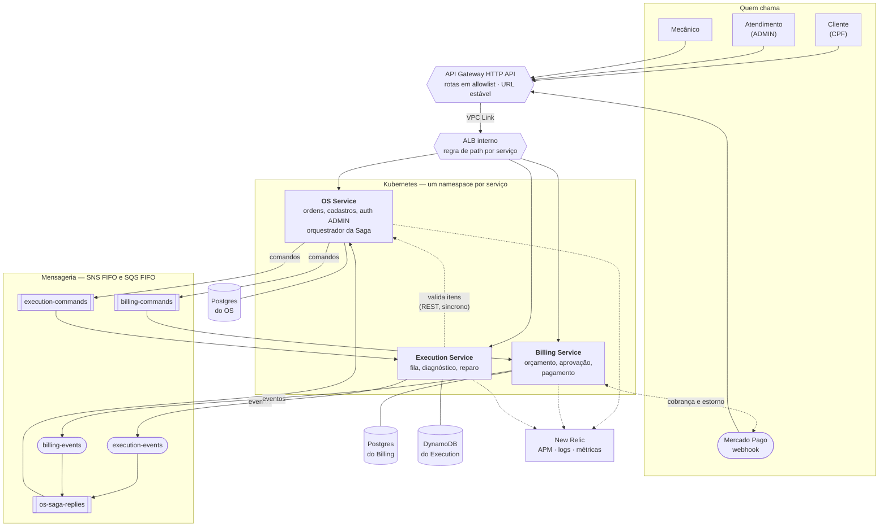

# Componentes — visão geral da Fase 4

> Escrito em 2026-10-18, no bloco do esqueleto andante. Os estados que estes componentes movem estão na
> [máquina de estados](maquina-de-estados.md); as mensagens que trafegam entre eles, no
> [catálogo de mensagens](catalogo-de-mensagens.md).

Três microsserviços independentes, cada um com repositório, infraestrutura e banco próprios. Nenhum deles lê o
banco de outro: o que atravessa a fronteira é **mensagem** ou **chamada de API**.

## Diagrama

## Quem é dono de quê

| Componente | Dono | Guarda | Fala com os outros por |
|---|---|---|---|
| **OS Service** | ordem de serviço, clientes, veículos, catálogo de serviços e peças, estoque, autenticação do ADMIN, **estado da Saga** | Postgres próprio | comandos no outbox; consome as respostas dos participantes |
| **Billing Service** | orçamento, aprovação do cliente, cobrança e estorno | Postgres próprio | consome comandos; publica eventos; chama o Mercado Pago |
| **Execution Service** | fila de execução por filial, diagnóstico e reparo | DynamoDB | consome comandos; publica eventos; consulta o catálogo do OS por REST |
| **Borda** | API Gateway, VPC Link, rotas | — | integra com o ALB interno; nenhum balanceador público |
| **Plataforma** | VPC, cluster, registries, ALB interno, **tópicos SNS** | — | publica o contrato no Parameter Store |

Os tópicos ficam na plataforma porque são o **contrato público de eventos**; cada fila fica no repositório de
quem a consome. O contrato entre repositórios é o Parameter Store sob `/fase4/`: cada um publica o que cria e
lê o que precisa, sem nenhum identificador fixo no código.

## Por que cada travessia de fronteira é assim

| Travessia | Forma | Por quê |
|---|---|---|
| Orquestrador → participante | **comando** numa fila ponto a ponto | o orquestrador fala com **um** destinatário, e a fila segura o participante fora do ar |
| Participante → orquestrador | **evento** num tópico, entregue na fila de respostas | o fato é público; quem tiver interesse assina, sem o participante conhecer o consumidor |
| Execution → catálogo do OS | **REST síncrono** | é feedback a um humano: item inválido tem de voltar na hora ao mecânico |
| Billing → Mercado Pago | REST síncrono, com confirmação por consulta | o webhook só avisa; o status verdadeiro vem da consulta ao pagamento |
| Pessoas → serviços | HTTPS pelo Gateway, com JWT | única porta de entrada; as rotas são uma allowlist explícita |

## Observabilidade

Uma entidade de APM **por serviço**, com o agente embutido na imagem. Os logs saem em JSON com `correlationId`,
`sagaId` e `branchId` como campos, inclusive na linha de erro, e o objetivo é seguir **a mesma ordem de serviço nos três
serviços** com uma consulta só. O traço distribuído atravessa a mensageria pelo contexto guardado no outbox
([ADR-010](adr/ADR-010-rastreamento-distribuido.md)).

| Peça | Onde | O que faz |
|---|---|---|
| `TraceContext` / `NewRelicTraceContext` | os 3, em `infrastructure/observability` | única porta para a API do agente: captura e aceita o contexto de traço, nomeia a transação e registra o erro tratado. Nunca lança |
| `trace_context` / `traceContext` | outbox do OS e do Billing; item `OUTBOX#` do Execution | o contexto do passo que gravou o evento; o relay só o copia para os atributos da mensagem |
| `SagaMetricsCollector` | OS | a cada 30 s, `saga_instances{state,branch}`, `saga_compensations{reason,branch}` e `saga_overdue{branch}`, com zero explícito em toda combinação |
| `DeadLetterQueueGauge` | os 3 | a cada 30 s, `saga_dlq_messages{queue}` da DLQ da fila que o serviço consome, achada pelo `RedrivePolicy`; falha de leitura vira `NaN`, nunca 0 |
| `WorkOrderMetricsInitializer` | OS | registra com zero, no boot, as séries `workorder_*` de cada status e filial, porque o New Relic perde o primeiro incremento de uma série nova |

O painel `Car Workshop — Fase 4` e a política de alertas de mesmo nome estão em `k8s/newrelic/` deste repositório e são
publicados pelos scripts de `scripts/`. O painel filtra por filial nas páginas de ordens de serviço, saga e pagamentos;
DLQ, API e infraestrutura mostram os 3 serviços. Os pagamentos são contados pela linha `<evento> published for Work Order`
do Billing, e um teste fixa esse texto.

## O que ainda não existe

Os componentes deste diagrama já rodaram juntos no EKS ([execuções de 2026-11-05](matriz-de-compensacao.md#execução-no-eks)).
A observabilidade distribuída está no código e foi medida num ambiente local com o agente real
([ADR-010](adr/ADR-010-rastreamento-distribuido.md)). Falta a prova no EKS:

- a travessia pelo SNS (Execution e Billing → OS), que não tem emulador local;
- o painel e os alertas publicados, e o alerta de DLQ disparando de verdade.
