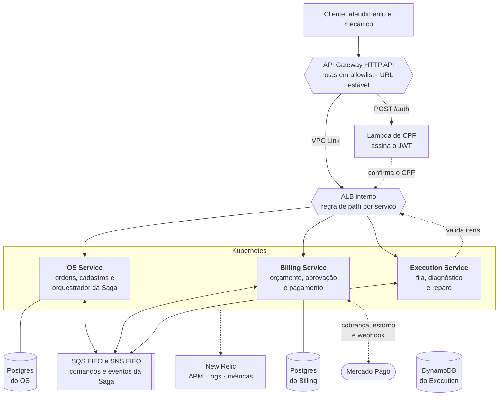

# Componentes — visão geral da Fase 4

> Escrito em 2026-10-18. Os estados que estes componentes movem estão na
> [máquina de estados](maquina-de-estados.md); as mensagens que trafegam entre eles, no
> [catálogo de mensagens](catalogo-de-mensagens.md).

Três microsserviços independentes, cada um com repositório, infraestrutura e banco próprios e com o próprio namespace no
cluster. Nenhum deles lê o banco de outro: o que atravessa a fronteira é **mensagem** ou **chamada de API**. As filas e os
tópicos, um a um, estão no [catálogo de mensagens](catalogo-de-mensagens.md).

## Diagrama

## Quem é dono de quê

| Componente | Dono | Guarda | Fala com os outros por |
|---|---|---|---|
| **OS Service** | ordem de serviço, clientes, veículos, catálogo de serviços e peças, estoque, autenticação do ADMIN, **estado da Saga** | Postgres próprio | comandos no outbox; consome as respostas dos participantes |
| **Billing Service** | orçamento, aprovação do cliente, cobrança e estorno | Postgres próprio | consome comandos; publica eventos; chama o Mercado Pago |
| **Execution Service** | fila de execução por filial, diagnóstico e reparo | DynamoDB | consome comandos; publica eventos; consulta o catálogo do OS por REST |
| **Borda** | API Gateway, VPC Link, rotas | — | integra com o ALB interno; nenhum balanceador público |
| **Plataforma** | VPC, cluster, registries, ALB interno, **tópicos SNS** | — | publica o contrato no Parameter Store |

Os tópicos ficam na plataforma porque são o **contrato público de eventos**; cada fila fica no repositório de
quem a consome. O contrato entre repositórios é o Parameter Store sob `/fase4/`: cada um publica o que cria e
lê o que precisa, sem nenhum identificador fixo no código.

## Por que cada travessia de fronteira é assim

| Travessia | Forma | Por quê |
|---|---|---|
| Orquestrador → participante | **comando** numa fila ponto a ponto | o orquestrador fala com **um** destinatário, e a fila segura o participante fora do ar |
| Participante → orquestrador | **evento** num tópico, entregue na fila de respostas | o fato é público; quem tiver interesse assina, sem o participante conhecer o consumidor |
| Execution → catálogo do OS | **REST síncrono** | é feedback a um humano: item inválido tem de voltar na hora ao mecânico |
| Billing → Mercado Pago | REST síncrono, com confirmação por consulta | o webhook só avisa; o status verdadeiro vem da consulta ao pagamento |
| Pessoas → serviços | HTTPS pelo Gateway, com JWT | única porta de entrada; as rotas são uma allowlist explícita |

## Por que três serviços e estas tecnologias

### A divisão

O corte segue as três responsabilidades de negócio do enunciado e o dono de cada dado
([ADR-005](adr/ADR-005-divisao-em-servicos.md)):

| Serviço | Decide sobre | Por que é um serviço próprio |
|---|---|---|
| **OS Service** | a ordem de serviço e seu status, os cadastros, o catálogo, o estoque, a autenticação do atendimento e o estado da Saga | a ordem é a entidade em volta da qual tudo gira, e cadastros e estoque mudam com ela, nas mesmas transações locais |
| **Billing Service** | o orçamento, a aprovação do cliente, a cobrança e o estorno | dinheiro tem regras, prazos e falhas próprios, e o provedor de pagamento fica atrás deste serviço |
| **Execution Service** | a fila por filial, o diagnóstico e o reparo | é o trabalho da oficina, dirigido pelo mecânico e acessado por chave |

Cortar por camada ou por entidade daria serviços que não decidem nada sozinhos: toda mudança de negócio exigiria deploys
coordenados, e abrir uma ordem viraria uma sequência de chamadas síncronas. Com o corte por responsabilidade, cada serviço
tem um motivo para mudar, e o banco próprio é consequência natural.

### As tecnologias

| Escolha | Para quê | Por quê |
|---|---|---|
| Quarkus 3.26.3 e Java 17 | os três serviços | a mesma stack da fase anterior, com testes, agente de observabilidade, Dockerfile e regras de arquitetura já validados |
| PostgreSQL no RDS, uma instância por serviço | OS e Billing | dinheiro e relações pedem transação ACID e constraints ([ADR-011](adr/ADR-011-bancos-sql-e-nosql.md)) |
| DynamoDB | Execution | o acesso é sempre por chave, sem junção ([ADR-009](adr/ADR-009-tabela-unica-do-execution.md), [ADR-011](adr/ADR-011-bancos-sql-e-nosql.md)) |
| Saga orquestrada, em código | coordenar o fluxo da ordem de serviço | compensações com ordem, prazos com dono e o fluxo completo testável no pull request ([ADR-001](adr/ADR-001-saga-orquestrada.md)) |
| SNS FIFO e SQS FIFO, com outbox | comandos e eventos da Saga | ordem por ordem de serviço, retentativa e descarte nativos e custo próximo de zero; Kafka e RabbitMQ não cabem no orçamento nem no cluster do laboratório ([ADR-006](adr/ADR-006-mensageria.md)) |
| REST síncrono | validação dos itens pelo mecânico e chamadas ao Mercado Pago | só onde uma pessoa espera a resposta ou o provedor exige ([catálogo §6](catalogo-de-mensagens.md)) |
| Mercado Pago, Checkout Pro | pagamento | o cliente paga numa página do provedor, e o status vem sempre da consulta ao pagamento ([ADR-008](adr/ADR-008-pagamento-mercado-pago.md)) |
| API Gateway, VPC Link e ALB interno | entrada única | nenhum balanceador público, rotas em allowlist e URL estável para o webhook ([ADR-003](adr/ADR-003-borda-privada.md), [ADR-004](adr/ADR-004-gateway-persistente.md)) |
| Lambda em Node.js | autenticação por CPF | herdada da fase anterior; agora consulta o OS por um endpoint interno, nunca o banco ([ADR-007](adr/ADR-007-lambda-sem-banco-do-os.md)) |
| EKS, Terraform e GitHub Actions | execução, infraestrutura e entrega | um pipeline independente por serviço até o Kubernetes, com a infraestrutura versionada |
| New Relic | observabilidade | reaproveitada da fase anterior e estendida para seguir uma ordem pelos três serviços ([ADR-010](adr/ADR-010-rastreamento-distribuido.md)) |
| SonarCloud, JaCoCo e Cucumber | qualidade | gate de cobertura de 80% e o fluxo completo em BDD como checks do pull request |

As restrições do laboratório que moldam estas escolhas estão em [Lab × Produção](lab-vs-producao.md).

## Observabilidade

Uma entidade de APM **por serviço**, com o agente embutido na imagem. Os logs saem em JSON com `correlationId`,
`sagaId` e `branchId` como campos, inclusive na linha de erro, e o objetivo é seguir **a mesma ordem de serviço nos três
serviços** com uma consulta só. O traço distribuído atravessa a mensageria pelo contexto guardado no outbox
([ADR-010](adr/ADR-010-rastreamento-distribuido.md)).

| Peça | Onde | O que faz |
|---|---|---|
| `TraceContext` / `NewRelicTraceContext` | os 3, em `infrastructure/observability` | única porta para a API do agente: captura e aceita o contexto de traço, nomeia a transação e registra o erro tratado. Nunca lança |
| `trace_context` / `traceContext` | outbox do OS e do Billing; item `OUTBOX#` do Execution | o contexto do passo que gravou o evento; o relay só o copia para os atributos da mensagem |
| `SagaMetricsCollector` | OS | a cada 30 s, `saga_instances{state,branch}`, `saga_compensations{reason,branch}` e `saga_overdue{branch}`, com zero explícito em toda combinação |
| `DeadLetterQueueGauge` | os 3 | a cada 30 s, `saga_dlq_messages{queue}` da DLQ da fila que o serviço consome, achada pelo `RedrivePolicy`; falha de leitura vira `NaN`, nunca 0 |
| `WorkOrderMetricsInitializer` | OS | registra com zero, no boot, as séries `workorder_*` de cada status e filial, porque o New Relic perde o primeiro incremento de uma série nova |

O painel `Car Workshop — Fase 4` e a política de alertas de mesmo nome estão em `k8s/newrelic/` deste repositório e são
publicados pelos scripts de `scripts/`. O painel filtra por filial nas páginas de ordens de serviço, saga e pagamentos;
DLQ, API e infraestrutura mostram os 3 serviços. Os pagamentos são contados pela linha `<evento> published for Work Order`
do Billing, e um teste fixa esse texto.

## Limites conhecidos

Os componentes deste diagrama já rodaram juntos no EKS ([execuções de 2026-11-05](matriz-de-compensacao.md#execução-no-eks)).
A observabilidade distribuída foi provada lá em 2026-11-06 e 2026-11-07 ([ADR-010](adr/ADR-010-rastreamento-distribuido.md)):
o traço atravessa o SNS nos dois sentidos e sai do webhook do Mercado Pago, o painel e a política estão publicados, o
alerta de DLQ abriu e fechou sozinho com a fila como alvo, e o `Healthcheck down` disparou pela perda de sinal no destroy,
com e-mail. Ficam sem prova:

- os outros 4 alertas (5xx, latência, saga parada e falha de pagamento), validados só pela consulta e pelo sinal;
- escalar por tráfego sustentado, porque o teste de carga ficou fora do escopo.
