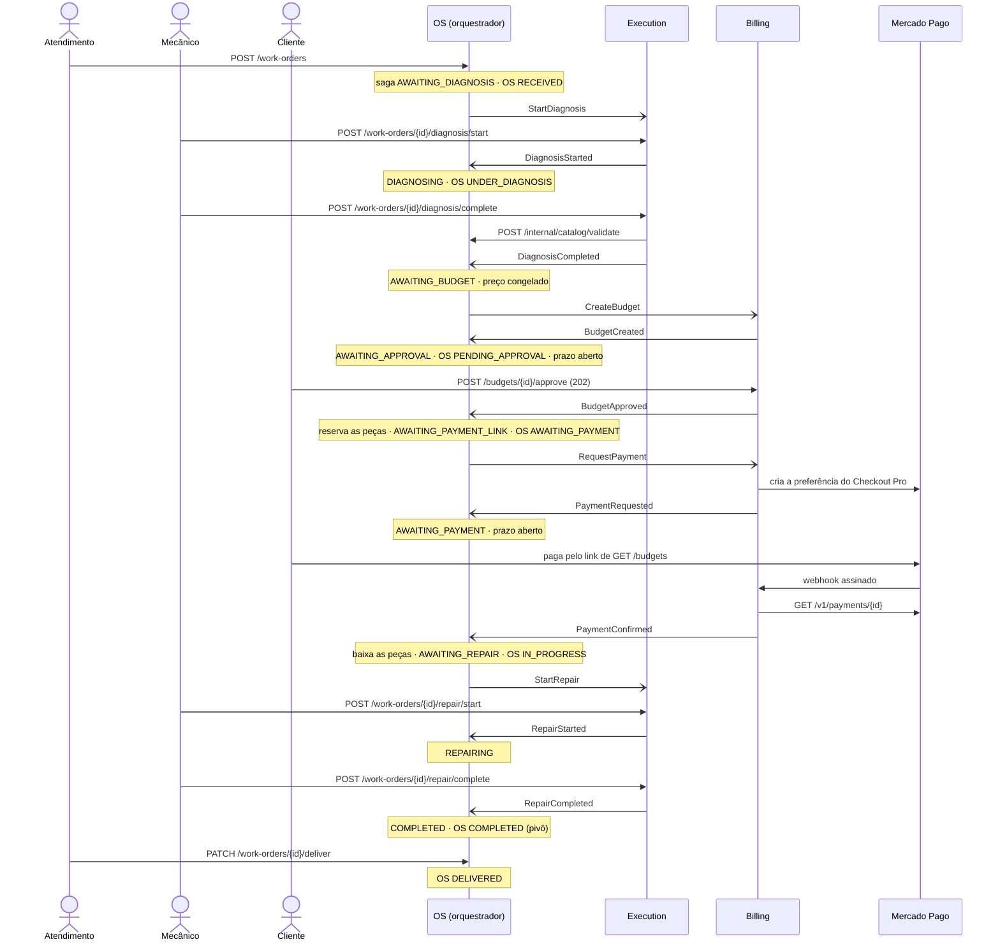
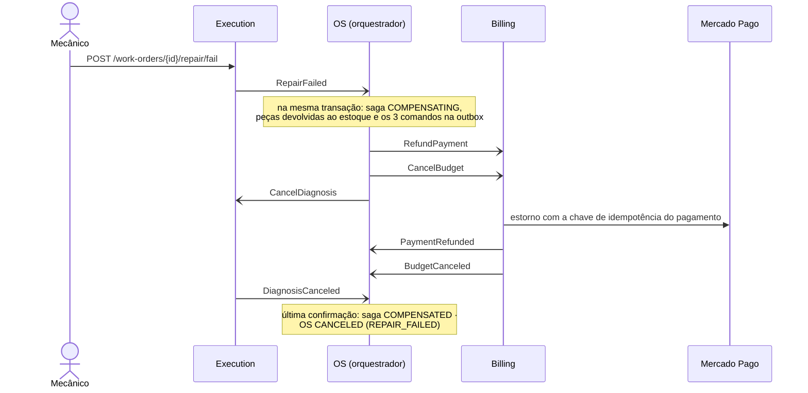
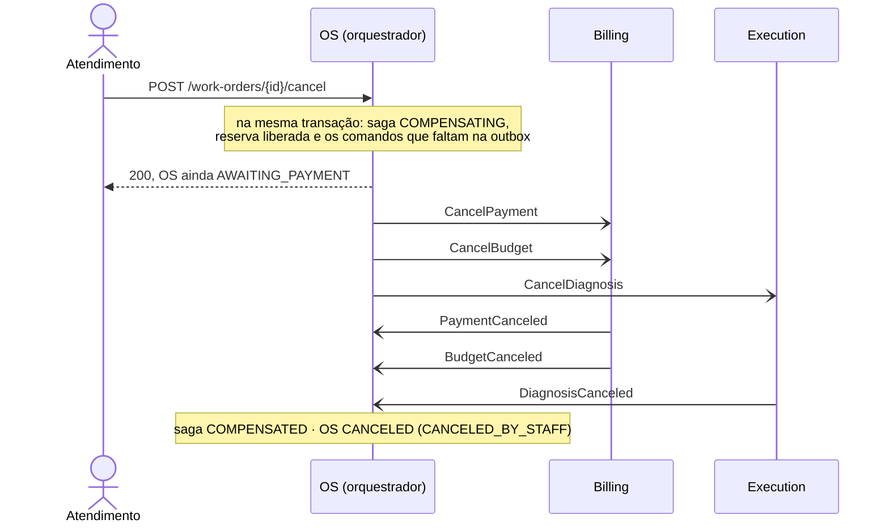

# Sequência da Saga

Três sequências: o caminho feliz, a compensação depois do pagamento (F6) e o cancelamento pelo atendimento.
Estados e motivos estão na [máquina de estados](maquina-de-estados.md); cada falha, na
[matriz de compensação](matriz-de-compensacao.md).

Como ler os diagramas:

- **Seta cheia** é chamada HTTP síncrona. **Seta aberta** é mensagem: outbox na mesma transação do negócio, relay,
  fila SQS FIFO e inbox do outro lado ([ADR-006](adr/ADR-006-mensageria.md)).
- Cada resposta é uma transação curta no orquestrador. Nenhuma transação atravessa dois serviços.

## Caminho feliz

O reparo concluído é o **pivô**: dali em diante nada se desfaz, e o cancelamento recebe **409**.

## Compensação depois do pagamento (F6)

A saga passa a `COMPENSATING` e a OS **continua** `IN_PROGRESS` até a última confirmação: o cliente nunca vê "cancelado"
com o dinheiro ainda retido.

**Se o estorno for recusado (F8):** o Billing não responde, a mensagem esgota as tentativas e vai para a
`billing-commands-dlq`, e a saga fica visível em `COMPENSATING` com `REFUND_PAYMENT` pendente, sem desistir. O
`CancelBudget` não depende dele: no EKS, em 2026-11-05, o orçamento foi cancelado enquanto o estorno ainda estava na
segunda tentativa. Quem resolve o estorno é o [runbook de redrive](runbook-redrive-dlq.md).

## Cancelamento pelo atendimento

O `POST /work-orders/{id}/cancel` responde **200** assim que a compensação começa. A OS ainda mostra o status
anterior e só vira `CANCELED` quando os participantes confirmam.

O diagrama mostra o cancelamento em `AWAITING_PAYMENT`. O que sai depende de onde a saga está
([`SagaState.java`](../../src/main/java/br/com/fiap/postech/carworkshop/saga/domain/entity/SagaState.java)):

| Estado da saga | Passo local, na hora | Comandos |
|---|---|---|
| `AWAITING_DIAGNOSIS`, `DIAGNOSING`, `AWAITING_BUDGET` | — | `CancelDiagnosis` |
| `AWAITING_APPROVAL` | — | `CancelBudget`, `CancelDiagnosis` |
| `AWAITING_PAYMENT_LINK` | libera a reserva | `CancelBudget`, `CancelDiagnosis` |
| `AWAITING_PAYMENT` | libera a reserva | `CancelPayment`, `CancelBudget`, `CancelDiagnosis` |
| `AWAITING_REPAIR`, `REPAIRING` | devolve as peças ao estoque | `RefundPayment`, `CancelBudget`, `CancelDiagnosis` |
| `COMPLETED` | — | nenhum: **409** |

## O que "na ordem" quer dizer

A matriz lista as compensações em ordem, e essa é a **ordem de emissão**, não uma espera entre passos. O orquestrador
grava todos os comandos na mesma transação
([`SagaOrchestrator.java`](../../src/main/java/br/com/fiap/postech/carworkshop/saga/usecase/interactor/SagaOrchestrator.java),
`compensate`) e não aguarda a confirmação de um para mandar o seguinte. Daí três consequências:

- **Entre filas não há ordem:** o Execution pode confirmar o `CancelDiagnosis` antes de o Billing começar o estorno.
- **Dentro de uma fila a ordem de entrega vale**, porque o grupo FIFO é a própria OS. O consumidor lê em lotes e segue
  depois de uma falha, então a falha de uma mensagem não segura as que vieram no mesmo lote, um risco conhecido registrado no
  [ADR-006](adr/ADR-006-mensageria.md). O relay envia por `occurred_at`, que tem
  resolução de 1 µs no Linux dos pods. Medido em 2026-11-03 com JDK 17: `Instant.now()` salta de 1 em 1 µs no Linux e
  a cada ~500 µs no Windows, onde dois comandos seguidos empatam. Por isso a ordem de emissão é provada no
  [`SagaOrchestratorTest`](../../src/test/java/br/com/fiap/postech/carworkshop/saga/usecase/interactor/SagaOrchestratorTest.java),
  e os cenários de BDD afirmam o conjunto de comandos.
- **Os passos locais acontecem na hora**, antes de qualquer participante responder.

A ordem entre comandos do mesmo participante não é regra de negócio: no Billing, `CancelBudget`, `CancelPayment` e
`RefundPayment` não dependem um do outro. O que a saga garante é outra coisa: a OS só vira `CANCELED` depois de
**todas** as confirmações.

## Evidências

Verificado em 2026-11-03: os três fluxos executados em
[`src/test/resources/features/saga/`](../../src/test/resources/features/saga), com participantes simulados por fila,
contra Postgres e filas FIFO reais em contêiner.

Executado no EKS em 2026-11-05: caminho feliz e F6 com pagamento real no ambiente de teste do provedor, e o cancelamento nos
três estados. Execuções e estado final em [`matriz-de-compensacao.md`](matriz-de-compensacao.md#execução-no-eks).
